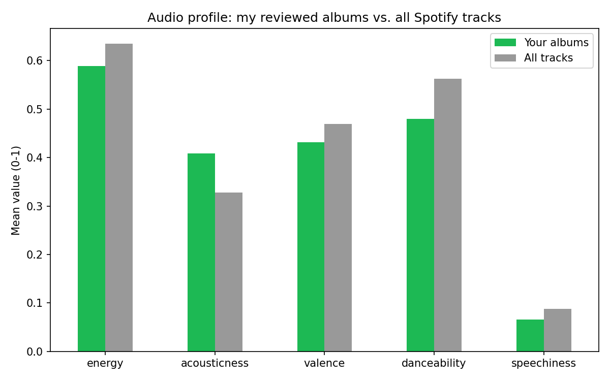
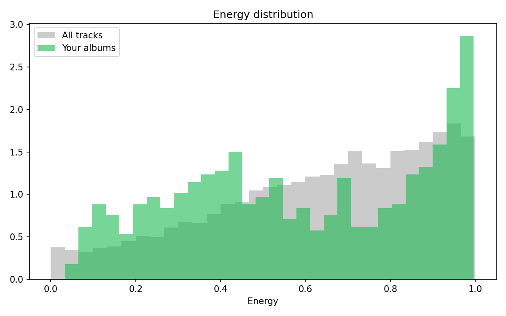

# What Does My Album Taste Sound Like?

A descriptive analysis of the albums I have reviewed, using Spotify audio features.

## Question
How do the albums I choose to review differ in sound from the average track on Spotify?

## Data
- Spotify Tracks Dataset (Kaggle, ~114,000 tracks): audio features such as energy, acousticness, valence, danceability. Download `dataset.csv` from https://www.kaggle.com/datasets/maharshipandya/-spotify-tracks-dataset (not included in this repo).
- My list of 102 reviewed albums (from my review site), in `album_reviews_seed.csv`. 94 unique album/artist pairs after cleaning.

## Method
1. Cleaned album and artist names (lowercase, removed punctuation and tags like "(Remastered)").
2. Matched my albums to dataset tracks by album and artist. 53 of 94 albums matched (706 tracks).
3. Compared mean audio features and the energy distribution against all tracks.

Python, pandas, matplotlib.

## Findings
- My albums average lower energy (0.59 vs 0.63), lower danceability (0.48 vs 0.56) and higher acousticness (0.41 vs 0.33) than the average track.
- The energy distribution is polarized: more quiet, low-energy tracks (0.1 to 0.45) and a larger spike at 0.95+ than the overall dataset. My taste sits at both extremes instead of the middle.

## Limitations
- 41 of 94 albums were not in the dataset, including most of my metal (for example Morbid Tales, Deicide, Schizophrenia) and all Chinese-language albums. The matched sample likely understates my high-energy listening.
- Spotify features are model estimates, and reviews are text only, so this describes sound and not how much I liked each album.

## Run it
`pip install pandas matplotlib`, download `dataset.csv` from Kaggle (link above), put it and `album_reviews_seed.csv` in the folder, then run `python match.py` (match summary) and `python chart.py` (saves the two charts).
